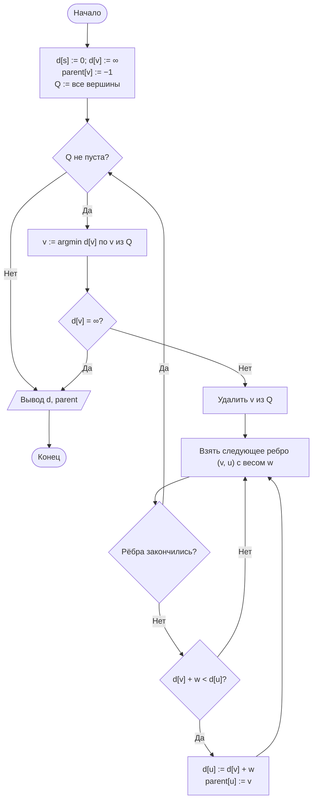
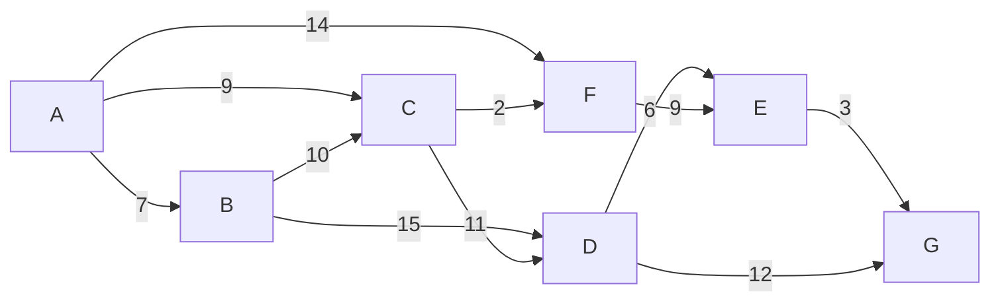
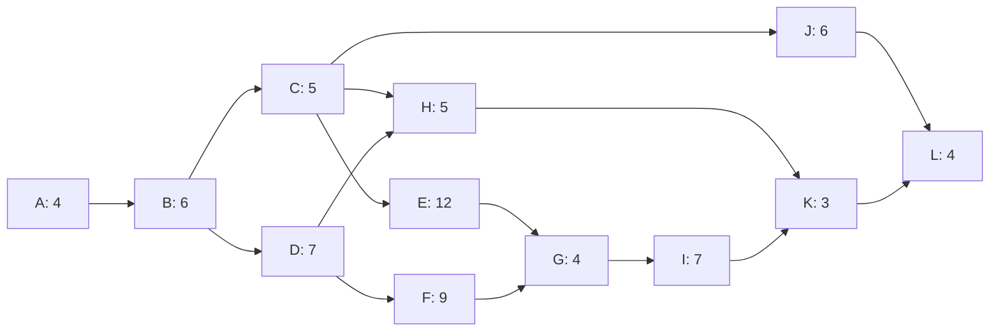

# Лабораторная работа № 10. Алгоритмы поиска кратчайших путей и расчёта критического пути сетевого графика

**Дисциплина:** Теория алгоритмов  
**Направление подготовки:** 38.03.05 «Бизнес-информатика»  
**Выполнила:** Кугушева Арина, группа БИ2-1  
**Вариант:** 13

| Файл | Назначение |
|---|---|
| `README.md` | описание работы, результаты и выводы (этот файл) |
| `lab10_variant13.py` | программа: Дейкстра (две реализации), топологическая сортировка, критический путь, проверка циклов |
| `report_lab10_variant13.pdf` | отчёт с титульным листом, схемами, листингом, таблицами и графиками |
---

## 1. Цель работы и задание варианта

**Цель работы:** изучить алгоритмы оптимизации на взвешенных графах, реализовать алгоритм Дейкстры в двух вариантах и применить топологическую сортировку к расчёту календарного плана проекта методом критического пути.

| Параметр | Значение |
|---|---|
| Графы для Дейкстры | разреженные, $m \approx 4n$ |
| Размеры $n$ | 2000; 4000; 8000 |
| Веса рёбер | 1…100 |
| Число работ в проекте | 12 |
| Дополнительное задание | К6 — обнаружение цикла в сетевом графике, сообщение о некорректных данных, проверка на графике с внесённым циклом |

## 2. Описание алгоритмов и трудоёмкость

| Алгоритм | Идея | Трудоёмкость |
|---|---|---|
| Дейкстра, линейный поиск | на каждом шаге ищется непросмотренная вершина с минимальным $d$ (просмотр всего массива), затем релаксация рёбер | $\Theta(n^2)$ |
| Дейкстра, двоичная куча | минимум извлекается из `heapq`; устаревшие записи пропускаются | $O(m \log n)$ |
| Восстановление пути | движение по массиву `parent` от цели к источнику, затем разворот | $O(\text{длина пути})$ |
| Топологическая сортировка (Кан) | вершины с входящей степенью 0 извлекаются из очереди, степени потомков уменьшаются; если упорядочены не все вершины — есть цикл | $\Theta(n+m)$ |
| Метод критического пути | прямой проход: $ES_i=\max EF_j$, $EF_i=ES_i+t_i$; обратный: $LF_i=\min LS_j$, $LS_i=LF_i-t_i$; резерв $R_i=LS_i-ES_i$ | $\Theta(n+m)$ |

Алгоритм Дейкстры требует неотрицательных весов (в работе все веса от 1 до 100).

### Блок-схема алгоритма Дейкстры



## 3. Тестовый граф и ручной расчёт кратчайших путей

Ориентированный граф из 7 вершин и 11 рёбер (изображение — в PDF, рис. 2):



Списки смежности: A: B(7), C(9), F(14); B: C(10), D(15); C: D(11), F(2); D: E(6), G(12); F: E(9); E: G(3).

**Ручной расчёт от вершины A.** Исходно $d[A]=0$, остальные $\infty$. На каждом шаге выбирается непросмотренная вершина с минимальным $d$ и релаксируются её рёбра:

| Шаг | Выбрана v (d) | A | B | C | D | E | F | G |
|---|---|---|---|---|---|---|---|---|
| 0 | — | 0 | ∞ | ∞ | ∞ | ∞ | ∞ | ∞ |
| 1 | A (0) | 0 | 7 | 9 | ∞ | ∞ | 14 | ∞ |
| 2 | B (7) | 0 | 7 | 9 | 22 | ∞ | 14 | ∞ |
| 3 | C (9) | 0 | 7 | 9 | 20 | ∞ | 11 | ∞ |
| 4 | F (11) | 0 | 7 | 9 | 20 | 20 | 11 | ∞ |
| 5 | D (20) | 0 | 7 | 9 | 20 | 20 | 11 | 32 |
| 6 | E (20) | 0 | 7 | 9 | 20 | 20 | 11 | 23 |
| 7 | G (23) | 0 | 7 | 9 | 20 | 20 | 11 | 23 |

Пояснения к шагам:

1. Выбрана **A** ($d=0$): из A: $d[B]=7$, $d[C]=9$, $d[F]=14$.
2. Выбрана **B** ($d=7$): из B (7): $d[D]=7+15=22$; путь в C через B дороже ($7+10=17>9$), оценка не меняется.
3. Выбрана **C** ($d=9$): из C (9): $d[D]=9+11=20<22$, $d[F]=9+2=11<14$.
4. Выбрана **F** ($d=11$): из F (11): $d[E]=11+9=20$.
5. Выбрана **D** ($d=20$): из D (20): $d[G]=20+12=32$; $d[E]$: $20+6=26>20$, не меняется.
6. Выбрана **E** ($d=20$): из E (20): $d[G]=20+3=23<32$.
7. Выбрана **G** ($d=23$): из G рёбер нет.

**Итог:** A: 0 (A); B: 7 (A → B); C: 9 (A → C); D: 20 (A → C → D); E: 20 (A → C → F → E); F: 11 (A → C → F); G: 23 (A → C → F → E → G).

Машинный расчёт программы совпал с ручным (`dijkstra_array` и `dijkstra_heap` дают одинаковые расстояния).

## 4. Сетевой график проекта

**Таблица работ (12 работ)**

| Код | Работа | $t$, дн. | Предшественники |
|---|---|---|---|
| A | Сбор требований | 4 | — |
| B | Анализ бизнес-процессов | 6 | A |
| C | Проектирование базы данных | 5 | B |
| D | Проектирование интерфейса | 7 | B |
| E | Разработка серверной части | 12 | C |
| F | Разработка клиентской части | 9 | D |
| G | Интеграция модулей | 4 | E, F |
| H | Подготовка документации | 5 | C, D |
| I | Тестирование | 7 | G |
| J | Подготовка инфраструктуры | 6 | C |
| K | Обучение пользователей | 3 | H, I |
| L | Внедрение | 4 | J, K |



В графике несколько параллельных ветвей: серверная часть, клиентская часть, документация и подготовка инфраструктуры. Цикл отсутствует (проверено топологической сортировкой).

## 5. Листинг программы

Полный текст — в файле [`lab10_variant13.py`](lab10_variant13.py) и в PDF-отчёте. Основные функции: `dijkstra_array`, `dijkstra_heap`, `dijkstra_trace`, `restore_path`, `generate_graph`, `topological_order` (с обнаружением цикла), `find_cycle`, `critical_path`.

```bash
python lab10_variant13.py                        # все эксперименты
python lab10_variant13.py --plots plots --json results.json
```

Полный запуск занимает около 40 секунд (основное время — версия с массивом при $n=8000$). Время зависит от компьютера, соотношения между реализациями и порядок роста — нет.

## 6. Результаты измерений: две реализации Дейкстры

Среда: Linux, Python 3.13.18. Время — медиана из 5 запусков при отключённом сборщике мусора, источник — вершина 0, генератор с seed = 42. Граф связный (остовное дерево плюс случайные рёбра), $m \approx 4n$.

**Таблица 1. Время работы**

| $n$ | $m$ | Массив, с | Куча, с | Отношение |
|---|---|---|---|---|
| 2 000 | 7 999 | 0,1495 | 0,0019 | 78,7 |
| 4 000 | 15 996 | 0,5797 | 0,0040 | 144,0 |
| 8 000 | 31 996 | 2,3941 | 0,0094 | 255,5 |

Рост при удвоении $n$: массив ×3,88, ×4,13 (теория ×4); куча ×2,12, ×2,33.

**Таблица 2. Самая удалённая вершина от источника**

| $n$ | Вершина | Расстояние | Вершин на пути |
|---|---|---|---|
| 2 000 | 1324 | 340 | 9 |
| 4 000 | 617 | 346 | 8 |
| 8 000 | 4011 | 360 | 10 |

График времени и отношения времён — в PDF-отчёте (рис. 4).

## 7. Расчёт сроков работ и критический путь

**Длительность проекта: 45 дней.**

| Работа | $t$ | $ES$ | $EF$ | $LS$ | $LF$ | Резерв $R$ | Критическая |
|---|---|---|---|---|---|---|---|
| **A** | 4 | 0 | 4 | 0 | 4 | 0 | да |
| **B** | 6 | 4 | 10 | 4 | 10 | 0 | да |
| **C** | 5 | 10 | 15 | 10 | 15 | 0 | да |
| D | 7 | 10 | 17 | 11 | 18 | 1 |  |
| **E** | 12 | 15 | 27 | 15 | 27 | 0 | да |
| F | 9 | 17 | 26 | 18 | 27 | 1 |  |
| **G** | 4 | 27 | 31 | 27 | 31 | 0 | да |
| H | 5 | 17 | 22 | 33 | 38 | 16 |  |
| **I** | 7 | 31 | 38 | 31 | 38 | 0 | да |
| J | 6 | 15 | 21 | 35 | 41 | 20 |  |
| **K** | 3 | 38 | 41 | 38 | 41 | 0 | да |
| **L** | 4 | 41 | 45 | 41 | 45 | 0 | да |

**Критический путь: A → B → C → E → G → I → K → L** (4 + 6 + 5 + 12 + 4 + 7 + 3 + 4 = 45).

Некритические работы: D (резерв 1), F (резерв 1), H (резерв 16), J (резерв 20).

## 8. Дополнительное задание К6: обнаружение цикла в сетевом графике

Алгоритм Кана упорядочивает работы по очереди нулевых входящих степеней. Если количество упорядоченных работ меньше общего, в графике есть цикл: работы цикла (и все зависящие от них) никогда не получают нулевую степень. Функция `topological_order` в этом случае выбрасывает `ValueError`, а `find_cycle` поиском в глубину (три цвета вершин) находит конкретный цикл.

| Проверка | Результат программы |
|---|---|
| Исходный график | график корректен, длительность 45 дн. |
| Внесён цикл: B зависит от I (ребро I → B) | Некорректные исходные данные: сетевой график содержит цикл. Работы, вошедшие в цикл или зависящие от него: B, C, D, E, F, G, H, I, J, K, L |
| Найденный цикл | B → C → E → G → I → B |
| Петля: E зависит от E | Некорректные исходные данные: сетевой график содержит цикл. Работы, вошедшие в цикл или зависящие от него: E, G, I, K, L |
| Предшественник Z не существует | Некорректные данные: работа L ссылается на несуществующего предшественника Z |

Схема искусственно внесённого цикла: B → D → F → G → I → B (рис. 3 в PDF-отчёте показывает сетевой график без цикла; цикл образуется добавлением ребра I → B). Расчёт сроков при некорректных данных не выполняется.

## 9. Выводы

1. Обе реализации алгоритма Дейкстры дали одинаковые расстояния на всех трёх графах (n = 2000, 4000, 8000) и на 200 случайных малых графах, где результат дополнительно сверялся с алгоритмом Беллмана — Форда. На тестовом графе из 7 вершин машинный расчёт совпал с ручным.
2. Версия с линейным поиском минимума ведёт себя как Θ(n²): при удвоении n время растёт в 3,9 и 4,1 раза (теория — 4), показатель степени по крайним точкам 2,00. Версия с кучей растёт почти линейно: в 2,1 и 2,3 раза за удвоение, показатель 1,15, что соответствует O(m log n) при m = 4n.
3. На разреженных графах преимущество кучи велико и растёт с n: в 79 раз при n = 2000, в 144 раз при n = 4000 и в 256 раз при n = 8000. Для n = 8000 массив работает 2,39 с, куча — 9,4 мс. Причина: массив тратит n² операций на поиск минимума даже при m = 4n, куча — около m log n.
4. Куча не всегда выигрывает: на плотных графах, где m = Θ(n²), оценки обеих реализаций близки, а куча тратит время на вставки и извлечения (для варианта 13 плотные графы не требовались, это общее следствие теории).
5. Путь восстанавливается по массиву предков за O(длина пути): в экспериментальных графах самый дальний путь содержит 8–10 вершин (расстояния 340–360), а сумма весов рёбер восстановленного пути совпала с найденным расстоянием.
6. Срок проекта из 12 работ — 45 дней, критический путь A → B → C → E → G → I → K → L. Работы D, F имеют резерв по 1 дню, H — 16 дней, J — 20 дней; их можно сдвигать в пределах резерва без изменения срока. Ветвь «проектирование интерфейса — клиентская часть» почти критическая: задержка более чем на день сделает её критической.
7. К6. Алгоритм Кана обнаруживает цикл: если после обработки очереди упорядочены не все работы, график некорректен. Программа выводит сообщение «Некорректные исходные данные», перечисляет работы, не вошедшие в порядок, и находит сам цикл поиском в глубину (B → C → E → G → I → B при внесении зависимости B от I). Дополнительно проверены петля (работа зависит от себя) и ссылка на несуществующего предшественника. Без этой проверки расчёт сроков невозможен, так как у работ цикла нет корректного раннего старта.
